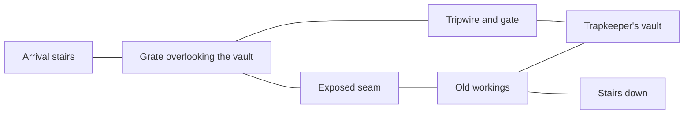

# Deeds of Legend and the next Four Lanterns Deep delve

Design review, November 27, 2026. The implementation in this change updates the rules credit. The mechanical changes below are the proposed conversion from Four Lanterns Deep 0.8.8.

## Sources and decisions

Compared FLD main `87f1d67` and its book pin `24e545e` with the current Deeds main `44ef046`. The latest published book tag at review was **v17.10.0** (`59610c9`). The following two main commits update links and branding metadata. The game's vendored Foundry modules are pinned at `137cbd9`. Even the renamed Foundry main's content lock at `55add40` still lists the old book commit. Read the current authored rules and active discipline index when validating a port. Counting every Markdown file includes superseded disciplines, and the book README's summary counts lag the active index. [Book development](https://github.com/bruceamoser/deeds-of-legend/blob/44ef046/design/development.md) · [active discipline index](https://github.com/bruceamoser/deeds-of-legend/blob/44ef046/design/disciplines.md) · [FLD source lock](hol-source-lock.json).

Bruce chose single-path masteries plus optional cross-discipline techniques. Balance levels 1–10 first and allow deeper descents. A potion discovery belongs to everyone in that saved run, including later parties. Existing heroes keep their equipment, XP and history and rebuild their choices by respec. Extremely rare resources can return one chosen fallen hero to life. Offer the run's Hall as the selection list. This extends the printed remains and time-window targeting. Keep the Hall entry as a death-and-return history. The proposed default carries forward the book's one lifetime return per hero across both resurrection spells and preserves spent Grit. A guaranteed shop purchase would defeat the intended rarity.

## Rule changes that affect play

| Area | What ships today | Deeds conversion |
|---|---|---|
| Resolution and initiative | Fixed outcome profiles, Boons/Banes, player attacks and defenses, alternating turns and reactions already have engine support. | Retain 3d6 plus one attribute, cancel Boons/Banes, retain best/worst three with up to three extra dice. Weak ≤8, Standard 9–14, Strong ≥15. Handle retained triples under their explicit exceptions. A successful ambush chooses the opening side. Otherwise unmodified 3d6 gives heroes the opening on 12+. The opening side starts each round. |
| Creation and advancement | Forge starts with 8 DP, awards 4 per later level and refunds 3 per duplicate origin. It removes class signatures and filters out universal basic attacks. | Fixed attributes from −2 to +2 totaling +3, two ancestry traits, three distinct discipline starts, class minimums. Start with 10 + Guile + Knowledge + Reason DP plus explicit traits. A further discipline costs its class price of 1–3 DP. Award 6 + new level DP from level 2. Independently choose a free class signature at 1, 3 and 7. Provide ordinary equipment needed by learned techniques and deduplicate compatible gear. Retain XP and safe-town training as FLD adaptations. |
| HP, SP and turn economy | Current derived HP begins at 14 plus ancestry, Fortitude and modifiers. Growth adds one per two levels before Forge purchases. Starting Grit is 3. The current Forge prices and at-will powers assume this economy. | Maximum HP is 10 + level × (ancestry HP + class HP) + Fortitude + fixed bonuses. SP capacity is 2 × level + ancestry SP + twice the positive base class casting attribute + explicit bonuses. An increase in capacity preserves current SP after creation. Keep free basic attacks and the first spell in each book at 0 SP. Use printed costs for stronger spells. |
| Damage and movement | Line of sight, reactions, conditions, collision bonuses and damage-type defenses already exist. | Remove immune components, then weakness, best matching resistance and other reductions. The minimum of 1 applies to attacks with surviving positive damage. Hazards, ticks and collisions can deal 0. Cover changes the actual roll by 1 or 3 dice. Melee/short/long/extreme reach 1/6/12/18 squares. Ordinary thrown and ranged attacks can reach one band farther at a penalty. Preserve explicit technique ranges. |
| Forced movement | Existing pushes and impact upgrades are usable foundations. | Push away, pull toward, let the user choose a slide path. Track the remaining movement, Stability per newly struck creature, independent defenses for each participant, breakable objects, fixed barrier +1 impact and only the original mover bouncing. Mark those results on the grid before committing. Keep voluntary disengagement, reaction-exempt technique steps, and forced movement distinguishable. |
| Dying and rescue | Wound tables, wound penalties, ongoing treatment and older Grit rules affect camp, action availability, the sheet and the infirmary. | At 0 HP a hero is prone, unconscious and Dying. Fortitude rolls track successes and failures separately. Weak marks failure, Strong marks success, Standard holds. Three successes stabilize, three failures kill unless interrupted. Further damaging events at 0 trigger immediate rolls. Adjacent Stabilize spends a Maneuver and leaves the hero conscious at 0, prone and unable to act. Grit comes at 1/3/7, is permanently spent and restores half maximum HP rounded up. Surviving the incident leaves a descriptive scar. |
| Rest, treatment and supplies | FLD camp currently simulates hourly healing and timed duties. Shops, carried supplies, refill, forage and interruption already exist. | A safe uninterrupted one-hour Brief Rest gives 6 HP and 3 SP once per day. A Night's Rest requires eight safe hours, six restful, food, water and shelter, once in 24 hours. It fills HP/SP and renews first aid. Normal first aid costs ten minutes and supplies, restores 2/4/6 HP and uses one attempt per **recipient** between safe nights. Stabilization and condition care are separate. Preview which duties are restful. Keep the no-passive-consumption-while-camping rule and explicitly define provisioning for a qualifying night to avoid double charging. |
| Magic, time and gear | Individual powers already support selected cells, zones, hand requirements, item discipline gates and resource effects. | Use the class casting attribute when specified. Check free hand or printed focus. Resolve casting provocation, recheck targets and then pay SP for ordinary spells. Rituals commit their printed time and upfront costs. One sustained spell per caster requires a Maneuver each following turn at 0 SP. Multi-target spells use one roll at the least favorable applicable modifier. Use strongest matching ongoing benefits and track expiry. Keep caster eligibility separate from what the party knows about an item. |
| Supplies and loot | Current game has inventory dice, caches, wearable slots, unique item generation, shop stock, recall and a fifth-floor guardian. | Keep the die ladder d20/d12/d10/d8/d6/d4/out, step down on a 1 after successful use. Replenishment advances the stated steps from empty at d4, subject to a cap. A refill source restores to the starting die. A lesser healing bottle gives 6 HP before Life resistance and checks d4. Record a potion's identity separately from the remaining supply. |

Read the authoritative [combat procedures](https://github.com/bruceamoser/deeds-of-legend/blob/44ef046/design/rules/foundations.md), [recovery](https://github.com/bruceamoser/deeds-of-legend/blob/44ef046/design/player-book/manuscript/08-recovery.md), [casting and sustain](https://github.com/bruceamoser/deeds-of-legend/blob/44ef046/design/rules/magic.md), [equipment and replenishment](https://github.com/bruceamoser/deeds-of-legend/blob/44ef046/design/player-book/manuscript/10-equipment.md) and [single-path masteries](https://github.com/bruceamoser/deeds-of-legend/blob/44ef046/design/combined-abilities.md). FLD comparison covers [Forge creation](../src/core/forge.mjs), [recovery](../src/core/recovery.mjs), [XP](../src/core/experience.mjs), [opportunity attacks](../src/core/opportunities.mjs) and [camp](../src/core/camp.mjs).

## What to borrow from Moria

| System | What the original or port actually does | What to build in FLD |
|---|---|---|
| Floor construction | Select room centers, vary forms with depth, shuffle centers and join them in a circuit. Tunnel intersections, doors, vaults, mineral seams, stairs and population are distinct passes. | Replace the current chain of up to nine rectangles connected horizontally then vertically. Start with a two-way loop, a locked shortcut and one optional guarded vault. Stage spawn and treasure placement after connectivity. Validate reachable exits with a four-hero formation, readable doorways at isometric scale and the fifth-floor guardian objective. A vault should tempt a party to leave the direct route. |
| Loose objects | Moria places objects and treasure on eligible floor tiles as well as in guarded rooms. Carrying capacity and the trip back make a modest find matter. | Reuse FLD's ground cache, hover, recipient selection, bulk and drop controls for loose finds. A quiver on a scout's perch, oil near an abandoned lantern and a valuable seam beside a noisy tunnel give different reasons to stop. Preserve supply dice. Show a single pile when drops share a tile. |
| Treasure allocation | Umoria selects a depth-eligible base item, occasionally samples deeper treasure, and applies type-specific magic, charges or curses. | Split reward budget, base item, compatible affix and power. Keep occasional early prizes and ordinary consumables at depth. Keep FLD's uniqueness ledger across shops, chests, deaths, recall and reload, and the base weapon's usefulness before qualifying for its enchantment. Tie an affix to a visible effect. Spend a common reward budget across floors, monsters and vaults so more sources do not silently multiply wealth. |
| Creature drops | Creature definitions flag money, objects, small objects and quantity chances. The death routine places eligible drops nearby. Observed treasure can feed monster memory. | Add per-family and per-role drop tables. A slain kobold trapkeeper might leave a recoverable snare, a wolf may yield hide for crafting, and a wisp may leave nothing. Let visible equipment influence the table. Record the resolved drop against the individual monster and floor visit before awarding treasure or XP. Test kills from burns, forced movement and load/resume. |
| Potions and identification | Appearance can hide an item's kind. Quaffing can identify an observable effect or mark a kind tried. Moria consumes the individual potion. | Seed appearances per run, share discoveries across heroes, and keep full-HP inconclusive tests marked tried. Quaff through the Deeds inventory die. Known shop stock gives a safe baseline. Offer a paid appraisal and Deeds Detection as alternatives. Detect Magic gives an aura clue. Identify is a ten-minute, 3-SP ritual and reveals 1/2/3 facts about activation, cost, duration or drawback. Keep per-kind potion knowledge separate from per-instance gear facts. Prevent unidentified effects leaking through price, comparison panels, icons or tooltips. |
| Town, retreat and memory | Shops rotate inventory. The original game sets a long-term goal deep below town. Recall makes retreat practical. Umoria also records observed monster behavior. | Keep Greyhaven's existing merchants, training, crafting, boss cadence and return passage to the **same floor state**. Retain reliably stocked essentials and rotate discretionary finds on elapsed expedition time. Put observed attacks, resistances and drop clues in a run-specific field journal beside the existing full model/art viewer. A retreat with discoveries can be a successful descent. |

Primary sources: [Koeneke's VMS generator](https://github.com/dungeons-of-moria/vms-moria/blob/adce6c8898ea280181f1277b47f104e2b1f387a8/source/include/generate.inc), [Umoria floor generation](https://github.com/dungeons-of-moria/umoria/blob/3bf8abc/src/dungeon_generate.cpp), [base item selection](https://github.com/dungeons-of-moria/umoria/blob/3bf8abc/src/game_objects.cpp), [enchantment](https://github.com/dungeons-of-moria/umoria/blob/3bf8abc/src/treasure.cpp), [creature drops](https://github.com/dungeons-of-moria/umoria/blob/3bf8abc/src/monster.cpp), [identification](https://github.com/dungeons-of-moria/umoria/blob/3bf8abc/src/identification.cpp), [quaffing](https://github.com/dungeons-of-moria/umoria/blob/3bf8abc/src/player_quaff.cpp), [store turnover](https://github.com/dungeons-of-moria/umoria/blob/3bf8abc/src/store_inventory.cpp) and [monster memory](https://github.com/dungeons-of-moria/umoria/blob/3bf8abc/src/recall.cpp). FLD counterparts are [generation](../src/core/dungeon.mjs), [floor population](../src/core/game.mjs), [gear and ground items](../src/core/treasure.mjs) and [market and recall](../src/core/market.mjs).

## A first playable floor — the Trapkeeper’s Toll

The party sees a locked supply vault through a grate near the stairs. The short route has a tripwire and a sentry. The long route follows an exposed mineral seam through the old workings. Either route leads back to the entrance. The next stairs remain accessible without opening the vault.

- **First route choice.** Subterfuge can disarm the wire and open the gate. Forcing the gate alerts the trapkeeper and changes where the fight begins. Taking the workings spends torch time and exposes a mining opportunity. Every party has a viable route, and the specialist changes the cost of taking it.
- **The encounter.** The keeper tries to reach its alarm instead of rushing the nearest hero. Pinning the keeper or using a Fencing step to occupy the alarm square has an observable payoff. A surviving snare can be recovered as a tool or ingredients.
- **The find.** A striped bottle rests beside the keeper's gear. Drinking it when its effect is observable can teach its kind to the run. Trying an antidote on a healthy hero leaves an inconclusive journal entry. A matching bottle in a reserve hero's pack updates when a later expedition discovers the answer. Players can recognize the stripe or pattern as well as the color.
- **The retreat.** Banking ore and paying the apothecary to identify a bottle compete for the same expedition time and carrying capacity. The existing recall scroll should bring the party back to the picked seam, opened gate and spent alarm. Umoria's delayed recall travels between town and deepest depth and requests a newly generated floor. FLD's persistent return passage gives the scouting information continuing value. [Umoria recall resolution](https://github.com/dungeons-of-moria/umoria/blob/3bf8abc/src/game_run.cpp#L863-L882).
- **A long-term prize.** A deep optional vault can very rarely contain a funerary reagent. Its journal entry explains which other component the Greyhaven priest needs. A completed rite consumes the resources, offers a single fallen hero from the run's Hall and records the return. Keep ordinary potion discoveries frequent enough that identifying a bottle pays off long before a party ever sees a resurrection component.

Judge the pilot by whether players use both routes with different parties, willingly bring back an unknown item, recognize it later, and choose to leave a vault untouched when the supplies or encounter risk say to retreat.

## Playable conversion order

1. Version the rules and save schema. Exercise copies of old runs containing reserve heroes, spent Grit, active combat, an open recall passage and Hall entries. Preserve IDs, inventory ownership, XP, death and injury history, and avoid repeating grants on respec. Propose translating recorded wounds to historical scars and retaining above-tier XP until higher-level balance is defined.
2. Implement the shared resolver, creation, HP/SP, dying, stabilization and rest before repricing purchases. Use fixed dice fixtures for edge cases. Exercise the camp and infirmary through the desktop UI.
3. Build one complete descent with Fencing, Tactics, Medicine and Detection. Put a trapkeeper, trapped optional room, unidentified bottle, useful drop and recall route on the same seeded floor. Verify that disabled choices give a reason, an interrupted action spends its costs at the proper moment, and the item and journal knowledge survive recall and reload.
4. Expand the reviewed paths and spells only when the promised interaction is available. Give each purchase a legal target, trigger, action/time cost, observable result and saved state. Verify reachability and useful alternatives at levels 1, 3, 7 and 10, including mixed builds and free basics. Rebalance encounter length, drops, retreat rate and DP spending against four heroes before extrapolating to deeper floors.

The [skill and tree review](deeds-tree-review.md) gives the dispositions and concrete play requirements. The installed release remains the baseline for comparison.
